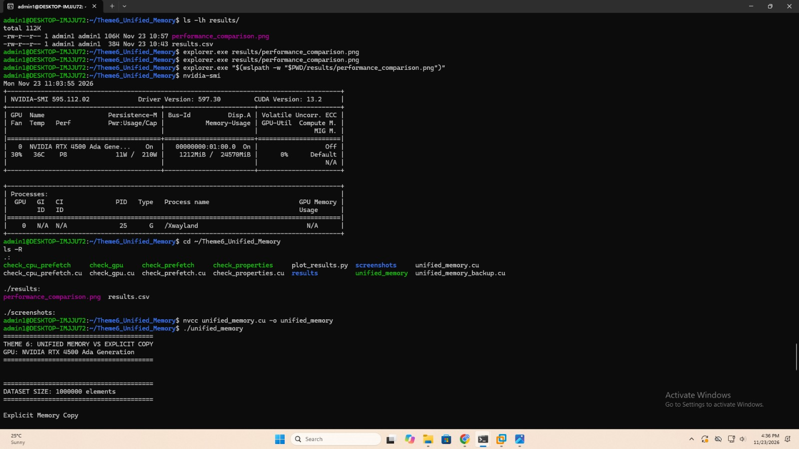
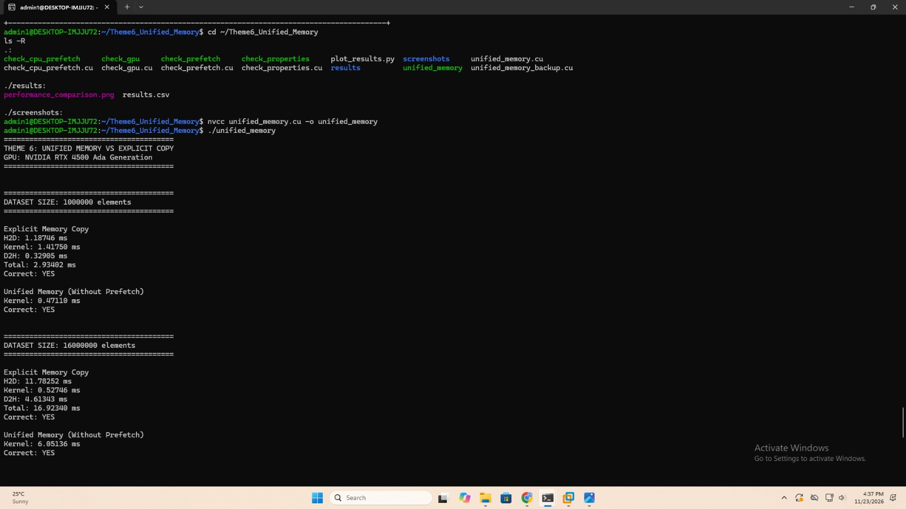
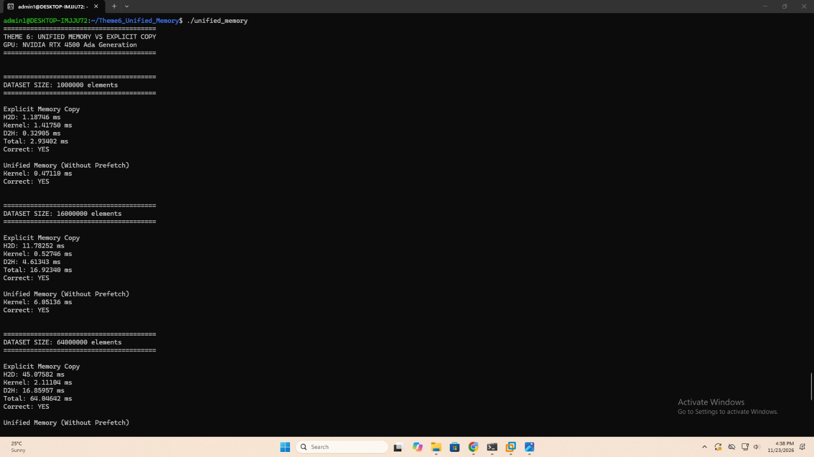
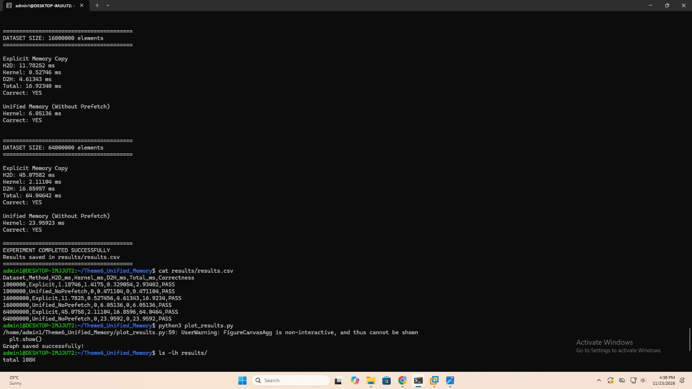
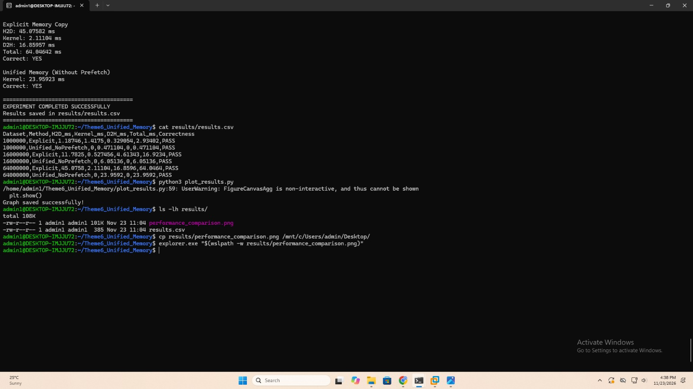
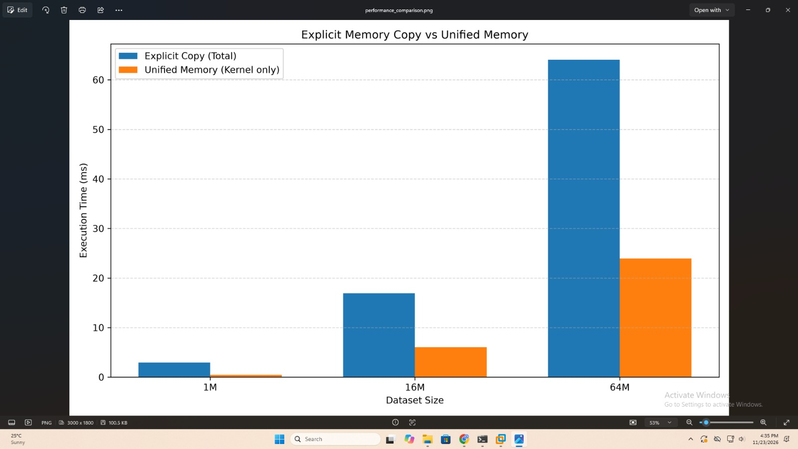

# Theme 6: Unified Memory vs Explicit Memory Copy in CUDA

## 1. Introduction

This experiment compares two memory management approaches in CUDA:

1. **Explicit Memory Copy** – Data is manually transferred between CPU memory and GPU memory using `cudaMemcpy()`.
2. **Unified Memory** – CPU and GPU access a shared managed memory allocation using `cudaMallocManaged()`. The CUDA runtime manages data movement automatically.

The experiment evaluates both approaches using different dataset sizes and checks the correctness of the results.

## 2. Aim

To implement and compare Explicit Memory Copy and CUDA Unified Memory, observe their execution timings for different dataset sizes, and understand how memory management affects GPU computation.

## 3. Objectives

- Understand Explicit Memory Copy in CUDA.
- Understand CUDA Unified Memory.
- Implement vector addition using both memory management approaches.
- Measure memory transfer and kernel execution times.
- Test the implementation with different dataset sizes.
- Verify the correctness of the computed results.
- Generate a performance comparison graph.

## 4. Hardware and Software Requirements

### Hardware Specifications

| Component | Specification |
|---|---|
| GPU | NVIDIA RTX 4500 Ada Generation |
| GPU Memory | 24,570 MiB |
| GPU Architecture | Ada Lovelace |
| Compute Capability | 8.9 |

### Software Specifications

| Component | Version / Details |
|---|---|
| Operating System | Ubuntu on WSL |
| CUDA Toolkit | CUDA 13.2 reported by NVIDIA driver |
| NVIDIA Driver | 597.30 |
| CUDA Compiler | NVCC |
| Programming Language | C++ with CUDA |
| Python | Python 3 |
| Graph Library | Matplotlib |

**Note:** The CUDA version displayed by `nvidia-smi` indicates the maximum CUDA version supported by the installed driver. The installed toolkit version can be checked using `nvcc --version`.

## 5. Theory

### 5.1 Explicit Memory Copy

In Explicit Memory Copy, the programmer manually manages memory allocation and data transfer between CPU and GPU.

The following CUDA functions are used:

- `cudaMalloc()` – Allocates memory on the GPU.
- `cudaMemcpy()` – Transfers data between CPU and GPU.
- `cudaFree()` – Releases GPU memory.

**Working:**

1. Allocate input and output arrays in CPU memory.
2. Allocate corresponding arrays in GPU memory.
3. Copy input data from CPU to GPU.
4. Execute the CUDA kernel.
5. Copy the output from GPU to CPU.
6. Verify the output.

**Memory flow:**

CPU Memory → GPU Memory → CUDA Kernel → CPU Memory

### 5.2 Unified Memory

Unified Memory provides a shared managed memory allocation that can be accessed by both CPU and GPU.

The following CUDA functions are used:

- `cudaMallocManaged()` – Allocates Unified Memory.
- `cudaDeviceSynchronize()` – Waits for GPU operations to complete.
- `cudaFree()` – Releases managed memory.

**Working:**

1. Allocate memory using `cudaMallocManaged()`.
2. Initialize input data on the CPU.
3. Execute the CUDA kernel using the managed memory.
4. Synchronize the GPU.
5. Access and verify the output on the CPU.

The CUDA runtime automatically manages data movement between CPU and GPU as required.

**Memory flow:**

CPU and GPU → Shared Managed Memory → CUDA Kernel

### 5.3 Difference Between Explicit Copy and Unified Memory

| Feature | Explicit Memory Copy | Unified Memory |
|---|---|---|
| Allocation | `cudaMalloc()` | `cudaMallocManaged()` |
| Data transfer | Manual | Automatically managed |
| Memory management | Programmer controlled | CUDA runtime managed |
| CPU and GPU access | Separate memory allocations | Shared managed allocation |
| Programming complexity | Higher | Lower |
| Data movement | Explicit `cudaMemcpy()` | Automatic migration as needed |

## 6. Implementation

The experiment implements Vector Addition using a CUDA kernel.

The operation performed is:

C[i] = A[i] + B[i]

Where:
- A and B are input arrays.
- C is the output array.
- Each CUDA thread calculates one element of the output array.

### Part A: Explicit Memory Copy

The implementation performs the following operations:

1. Create input arrays in host memory.
2. Allocate device memory using `cudaMalloc()`.
3. Transfer input arrays using `cudaMemcpy()`.
4. Execute the vector addition kernel.
5. Transfer the output back to host memory.
6. Measure H2D, kernel, D2H, and total execution time.
7. Verify the output.

### Part B: Unified Memory

The implementation performs the following operations:

1. Allocate arrays using `cudaMallocManaged()`.
2. Initialize the input arrays on the CPU.
3. Execute the vector addition kernel.
4. Synchronize the GPU.
5. Verify the output.
6. Measure kernel execution time.

**Important implementation detail:**

This experiment uses Unified Memory without explicit prefetching. The `cudaMemPrefetchAsync()` calls were excluded because prefetch operations returned `invalid device ordinal` in the WSL environment.

The managed memory allocation and kernel execution worked successfully without explicit prefetching.

## 7. Dataset Sizes

The experiment uses three different dataset sizes:

| Test | Number of Elements |
|---|---:|
| Test 1 | 1,000,000 |
| Test 2 | 16,000,000 |
| Test 3 | 64,000,000 |

Each element is a floating-point value.


```


## 8. Execution Steps

### Step 1: Open the project directory

```bash
cd ~/Theme6_Unified_Memory
```

### Step 2: Check GPU availability

```bash
nvidia-smi
```

### Step 3: Check CUDA compiler

```bash
nvcc --version
```

### Step 4: Compile the CUDA program

```bash
nvcc unified_memory.cu -o unified_memory
```

### Step 5: Execute the program

```bash
./unified_memory
```

The program executes both memory management approaches for all three dataset sizes.

### Step 6: View the CSV results

```bash
cat results/results.csv
```

### Step 7: Generate the performance graph

```bash
python3 plot_results.py
```

### Step 8: Open the generated graph

```bash
explorer.exe "$(wslpath -w results/performance_comparison.png)"
```

The graph is saved as:

`results/performance_comparison.png`

## 09. Experimental Results

The experiment was executed successfully on the NVIDIA RTX 4500 Ada Generation GPU.

### 09.1 Explicit Memory Copy Results

| Dataset Size | H2D (ms) | Kernel (ms) | D2H (ms) | Total (ms) |
|---:|---:|---:|---:|---:|
| 1,000,000 | 1.18746 | 1.41750 | 0.32905 | 2.93402 |
| 16,000,000 | 11.78252 | 0.52746 | 4.61343 | 16.92340 |
| 64,000,000 | 45.07582 | 2.11104 | 16.85957 | 64.04642 |

### 09.2 Unified Memory Results

| Dataset Size | Kernel Execution Time (ms) | Correctness |
|---:|---:|---|
| 1,000,000 | 0.47110 | PASS |
| 16,000,000 | 6.05136 | PASS |
| 64,000,000 | 23.95923 | PASS |

### 09.3 Correctness Verification

All six tests completed successfully.

| Dataset Size | Explicit Copy | Unified Memory |
|---:|---|---|
| 1,000,000 | PASS | PASS |
| 16,000,000 | PASS | PASS |
| 64,000,000 | PASS | PASS |

The output of every vector addition was verified successfully.

## Experimental Screenshots

## Experimental Screenshots










-------
## 10. Performance Graph

The experiment generates a graph comparing the recorded execution times of Explicit Memory Copy and Unified Memory.




-----
### Graph Interpretation

- Explicit Memory Copy total time includes Host-to-Device transfer, kernel execution, and Device-to-Host transfer.
- Unified Memory time represents the measured kernel execution time.
- Execution times increase with larger dataset sizes.
- The Unified Memory implementation successfully performs the vector addition without manual memory copy operations.

**Important measurement limitation:**

The two plotted measurements do not cover the same timing scope.

Explicit Memory Copy reports total transfer and kernel time, while Unified Memory reports kernel event time only. Unified Memory's CPU initialization, migration and other end-to-end costs are not included in that reported number.

Therefore, the graph is a comparison of the recorded measurements, not a direct end-to-end performance comparison. It should not be used to claim that Unified Memory is faster overall.

## 11. CUDA Unified Memory Capability Observation

During the experiment, GPU properties were checked.

| Property | Observed Value |
|---|---|
| GPU Count | 1 |
| Device ID | 0 |
| Unified Addressing | Supported |
| Managed Memory | Supported |
| Concurrent Managed Access | Not supported |

The GPU supports Unified Memory allocation and usage.

However, Concurrent Managed Access was reported as unsupported in this environment. This is a separate capability from basic Managed Memory support.

Explicit prefetch operations were also tested but returned `invalid device ordinal`, so prefetching was not included in the final implementation.


## 12. Conclusion

In this experiment, Explicit Memory Copy and CUDA Unified Memory were successfully implemented using vector addition.

Both approaches were tested with 1 million, 16 million, and 64 million elements.

All six correctness checks passed successfully.

Explicit Memory Copy required manual data transfers between CPU and GPU memory, while Unified Memory simplified memory management by using managed allocations and automatic data migration.

The experiment demonstrates the basic working of both memory management approaches and shows how CUDA handles memory movement during GPU computation.

A fair performance comparison would require measuring equivalent end-to-end execution times for both approaches, including data initialization, transfers or migration, synchronization, and output access.

